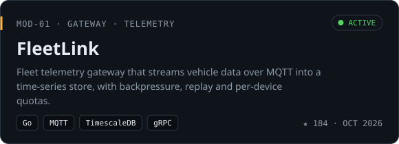
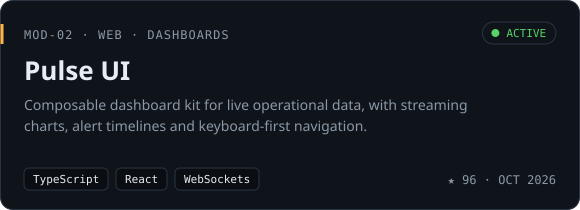

<a name="readme-top"></a>

<div align="center">

<h1 align="center">Diagnostic Profile</h1>

<p align="center">Turn your GitHub profile README into a live diagnostic console.</p>

[![CI Status][ci-shield]][ci-link]
[![MIT License][license-shield]][license-link]
[![Node.js][node-shield]][node-link]

</div>

[ci-shield]: https://github.com/YagoBorba/diagnostic-profile/actions/workflows/ci.yml/badge.svg?branch=develop
[ci-link]: https://github.com/YagoBorba/diagnostic-profile/actions/workflows/ci.yml
[license-shield]: https://img.shields.io/badge/License-MIT-508CF9?style=flat-square&labelColor=black
[license-link]: LICENSE
[node-shield]: https://img.shields.io/badge/Node.js-22-5FA04E?style=flat-square&logo=nodedotjs&logoColor=white&labelColor=black
[node-link]: https://nodejs.org/

<picture>
  <source media="(prefers-color-scheme: dark)" srcset="docs/preview/header-dark.svg">
  <source media="(prefers-color-scheme: light)" srcset="docs/preview/header-light.svg">
  
</picture>

## About the Project

Diagnostic Profile is a GitHub Action and CLI that renders a complete profile README kit as self-hosted SVGs: an animated header, a telemetry cluster with your GitHub stats, a weekly contribution spectrum, project cards and contact buttons. Everything is styled like an instrument panel, with readouts, PIDs, gauges and an oscilloscope.

It started as the profile of [YagoBorba](https://github.com/YagoBorba) after the popular stats card services kept returning errors. Instead of depending on third-party image servers, every asset is generated from the GitHub GraphQL API inside your own workflow and published to a branch of your profile repository.

- **No external image services.** Assets are plain SVG files served from your own repository.
- **Dark and light variants** for every widget, switched with `<picture>` so they follow the viewer's GitHub theme.
- **Text alternatives.** SVGs include title/description and snippet images include alt text. An optional text summary complements the images; real GitHub screen-reader verification remains pending.
- **Motion that respects the viewer.** Animations stop under `prefers-reduced-motion`.
- **Zero dependencies.** Plain Node.js 22, nothing to install.

## Start here

Create a plain Markdown README in the Studio without a token or installation, or choose SVGs with Action for styled panels and live metrics. Follow the [beginner guide](docs/GETTING_STARTED.md). Open the free [public Studio](https://yagoborba.github.io/diagnostic-profile/). The source and versioned Action are public. See the [product review and free hosting plan](docs/PRODUCT_REVIEW.md).

## Profile Studio

Build a profile visually with ten presets, six palettes and three families: Diagnostic, Terminal and Minimal. Edit profile fields, projects and contacts, reorder blocks, compare styles and export a standalone README or matching SVG configuration, snippet and workflow. Search templates by goal and clear the fictional sample before publishing.

    npm ci
    npm run studio

Studio uses clearly labeled fictional data and the same rendering engine as the CLI and Action. It includes narrow variants, custom colors with contrast feedback, local drafts/favorites, JSON import, share links and ZIP export. [Studio guide](docs/STUDIO.md).

## Widgets

| Widget | File | What it shows |
| --- | --- | --- |
| Header | `header-{mode}.svg` | Name, headline, up to three readouts, up to six PID tags and an animated oscilloscope. |
| Telemetry | `telemetry-{mode}.svg` | Contributions gauge, commits, pull requests, issues, stars, repositories, followers, streaks and language mix. |
| Spectrum | `spectrum-{mode}.svg` | Contributions per week over the last 52 weeks on a log scale, so quiet weeks still show. |
| Project card | `project-{repo}-{mode}.svg` | Module label, push recency (recent, older or unknown), summary, tags, stars and last push. |
| Contact button | `contact-{id}-{mode}.svg` | A compact link button with a glyph port. |
| Footer | `footer-{mode}.svg` | End-of-report line with the last scan timestamp. |

Additional blocks: skills, currently learning/building, contribution calendar, milestones and divider. Widget IDs are configurable file prefixes. Push recency uses a 60-day window; inactivity is not presented as proof of stability. Unavailable stars are displayed as unavailable rather than zero.

The run also writes `README.snippet.md`, ready to paste into your profile README.

<details>
<summary>See every widget</summary>

<picture>
  <source media="(prefers-color-scheme: dark)" srcset="docs/preview/telemetry-dark.svg">
  <source media="(prefers-color-scheme: light)" srcset="docs/preview/telemetry-light.svg">
  
</picture>

<picture>
  <source media="(prefers-color-scheme: dark)" srcset="docs/preview/spectrum-dark.svg">
  <source media="(prefers-color-scheme: light)" srcset="docs/preview/spectrum-light.svg">
  
</picture>

<p align="center">
  <picture>
    <source media="(prefers-color-scheme: dark)" srcset="docs/preview/project-fleetlink-dark.svg">
    <source media="(prefers-color-scheme: light)" srcset="docs/preview/project-fleetlink-light.svg">
    
  </picture>
  <picture>
    <source media="(prefers-color-scheme: dark)" srcset="docs/preview/project-pulse-ui-dark.svg">
    <source media="(prefers-color-scheme: light)" srcset="docs/preview/project-pulse-ui-light.svg">
    
  </picture>
</p>

</details>

## Themes

Pick one with the `theme` key. Each palette has a dark and a light variant.

| `amber` | `phosphor` |
| --- | --- |
|  |  |
| `ice` | `ember` |
|  |  |

## Quick Start

For a plain README, use the [public Studio](https://yagoborba.github.io/diagnostic-profile/) without a token. For SVGs with updated public GitHub data, install the versioned Action below. See [release and rollback instructions](docs/RELEASE.md).

1. In your profile repository (`<user>/<user>`), add a `diagnostic-profile.json`:

```json
{
  "login": "your-login",
  "theme": "amber",
  "header": {
    "headline": "Backend Developer · Cloud & DevOps",
    "readouts": [
      { "label": "Role", "value": "Backend-first" },
      { "label": "Base", "value": "Somewhere, Earth" }
    ],
    "tags": ["BACKEND", "DEVOPS", "OPEN SOURCE"]
  },
  "contacts": [
    { "id": "email", "label": "Email", "url": "mailto:you@example.com", "glyph": "@" }
  ]
}
```

2. Add `.github/workflows/profile.yml`:

```yaml
name: Build profile assets

on:
  schedule:
    - cron: "17 */6 * * *"
  workflow_dispatch:
  push:
    branches:
      - main

permissions:
  contents: write

jobs:
  build:
    runs-on: ubuntu-latest
    steps:
      - uses: actions/checkout@v4

      - uses: YagoBorba/diagnostic-profile@v0.1.0
        with:
          config: diagnostic-profile.json
          output_dir: dist

      - uses: crazy-max/ghaction-github-pages@v4
        with:
          target_branch: output
          build_dir: dist
        env:
          GITHUB_TOKEN: ${{ secrets.GITHUB_TOKEN }}
```

3. Run the workflow once, open `README.snippet.md` on the `output` branch and paste it into your `README.md`.

> [!NOTE]
> The default setup targets public GitHub data. Private contribution visibility depends on the account and token permissions and is not promised by this release. Keep tokens in Actions secrets; never paste them into Studio or exported JSON.

## Configuration Reference

| Key | Default | Description |
| --- | --- | --- |
| `login` | workflow owner | GitHub login to scan. |
| `theme` | `amber` | `amber`, `phosphor`, `ice`, `ember`, `monochrome` or `violet`. |
| `assetsBaseUrl` | `https://raw.githubusercontent.com/<login>/<login>/output/` | Base URL used in the generated snippet. |
| `header.name` | profile name | Large title in the header. |
| `header.headline` | profile bio | Subtitle under the name. |
| `header.prompt` | `$ scan --target <login>` | Terminal prompt above the name. |
| `header.systemLabel` | `DEVELOPER PROFILE` | Label in the header status bar. |
| `header.readouts` | `[]` | Up to three `{ "label", "value" }` pairs. |
| `header.tags` | `[]` | Up to six focus areas, rendered as PID chips. Chips that do not fit are skipped. |
| `projects` | `"pinned"` | Up to eight `{ "repo", "title", "kind", "summary", "tags", "url" }` objects, or `"pinned"` to use your pinned repositories. |
| `contacts` | `[]` | `{ "id", "label", "url", "glyph" }` objects. `glyph` takes up to three characters. |
| `telemetry.excludeLanguages` | markup and build files | Languages left out of the language mix. |
| `telemetry.languageLimit` | `7` | Languages shown before grouping the rest as Other. |
| `footer.message` | `NO FAULTS DETECTED` | Middle part of the footer line. |

### Composition and presets

Choose a preset with preset: diagnostic, terminal, minimal, opensource, student or portfolio. Explicit settings override its defaults.

- appearance: family, motion, density, borders, decorations and per-mode colors.
- layout: standard/compact/grid, project columns, HTML alignment, image theme, incorporation format, headings and text summary.
- widgets: ordered objects with id, type, enabled and optional title. Up to 16 unique instances.
- content: manual skills, learning, building and timeline lists.
- destination: asset repository and branch, independent of the scanned account.

The [JSON Schema](schema/diagnostic-profile.schema.json) describes all types and limits. [Preset gallery](docs/GALLERY.md).

## Local Development

```bash
npm ci
npm test
npm run preview
node src/cli.mjs --config examples/diagnostic-profile.json --fixture test/fixtures/user.json --output dist
```

`npm run preview` regenerates `docs/preview` from the fictional profile in `examples/` and `test/fixtures/`. CI fails when the committed previews drift from the code.

### CLI setup and checks

```bash
node src/cli.mjs init --login your-login
node src/cli.mjs validate
node src/cli.mjs doctor
node src/cli.mjs list-themes
node src/cli.mjs list-widgets
node src/cli.mjs list-presets
node src/cli.mjs preview
node src/cli.mjs --fixture test/fixtures/user.json --dry-run --json
```

`init` creates a schema-enabled config and an example workflow, without replacing existing files unless `--force` is supplied. The generated workflow uses `@v0.1.0`; pin the tag's full commit SHA if you require an immutable reference. Review release notes before upgrading.

Configuration without `schemaVersion` is interpreted as version 1; unsupported future versions fail before generating assets. [JSON Schema](schema/diagnostic-profile.schema.json) provides editor completion. CLI validation also reports misspelled/unknown fields. Precedence is `--login`, then file login, then `DP_LOGIN`, then defaults for optional fields.

`--json` returns structured results and `--dry-run` lists output without writing it. `doctor` reports environment/token presence without revealing credentials; it does not claim to verify live permissions. Builds write a SHA-256 manifest and stage the complete result before replacing output. Previous results are preserved on staging failure; unrelated files and manually edited stale assets are retained. A build lock prevents overlapping writes. After a process crash, inspect the sibling `.diagnostic-profile-lock` directory before removing it and retrying.

The rendering engine and Action have zero runtime dependencies. Development uses an XML parser to validate generated SVGs; run `npm ci` before tests.

### Data scope

Contribution, commit, pull request and issue counts cover the contribution calendar returned by GitHub (the last 12 months). Followers and stars are current totals, not gains during that period. The language mix measures code size, not coding time or skill.

Stars and languages include all public, owned, non-fork repositories, with pagination. Project cards can use `owner/repository` in `repo`, including repositories owned by an organization. These cards do not change the profile totals. Private project cards are not exported. The token may affect contribution counts; review your generated assets before publishing them.

Configuration validates types, text lengths, contact IDs and project filename collisions. `telemetry.languageLimit` accepts integers from 1 to 10. Contacts accept `https:`, `http:` and `mailto:` URLs; project and asset URLs accept HTTP(S). Contact IDs must remain unique after normalization.

## Roadmap

The [complete roadmap](docs/ROADMAP.md) and [implementation evidence](docs/IMPLEMENTATION.md) distinguish delivered work from pending proposals.

- [ ] Recent activity as a fault code log (pull requests, reviews and releases as DTC entries)
- [ ] Achievements as readiness monitors
- [ ] Contribution heatmap styled as an ECU memory map
- [ ] Coding time readout from WakaTime
- [ ] Latest posts and releases feed
- [ ] Section divider SVGs
- [ ] YAML config support
- [ ] Marketplace release

## License

Distributed under the MIT License. See [LICENSE](LICENSE) for details.

<p align="right"><a href="#readme-top">Back to top</a></p>
