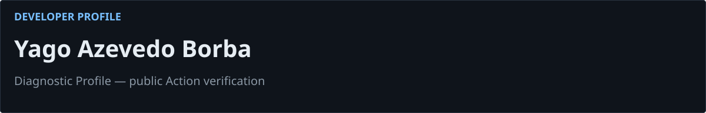
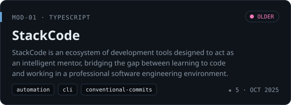
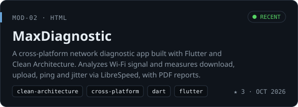
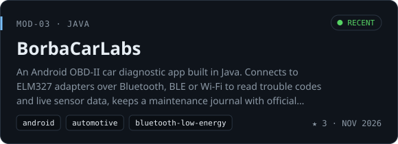
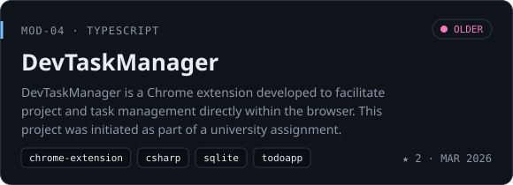
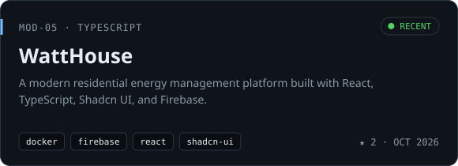
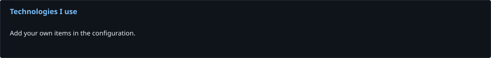
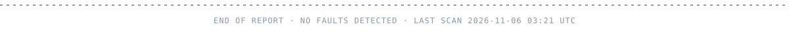

<picture>
  <source media="(prefers-color-scheme: dark)" srcset="https://raw.githubusercontent.com/YagoBorba/diagnostic-profile/demo-assets/header-dark.svg">
  <source media="(prefers-color-scheme: light)" srcset="https://raw.githubusercontent.com/YagoBorba/diagnostic-profile/demo-assets/header-light.svg">
  
</picture>

## Featured projects

<a href="https://github.com/YagoBorba/StackCode">
<picture>
  <source media="(prefers-color-scheme: dark)" srcset="https://raw.githubusercontent.com/YagoBorba/diagnostic-profile/demo-assets/project-stackcode-dark.svg">
  <source media="(prefers-color-scheme: light)" srcset="https://raw.githubusercontent.com/YagoBorba/diagnostic-profile/demo-assets/project-stackcode-light.svg">
  
</picture>
</a>
<a href="https://github.com/YagoBorba/MaxDiagnostic">
<picture>
  <source media="(prefers-color-scheme: dark)" srcset="https://raw.githubusercontent.com/YagoBorba/diagnostic-profile/demo-assets/project-maxdiagnostic-dark.svg">
  <source media="(prefers-color-scheme: light)" srcset="https://raw.githubusercontent.com/YagoBorba/diagnostic-profile/demo-assets/project-maxdiagnostic-light.svg">
  
</picture>
</a>
<a href="https://github.com/YagoBorba/BorbaCarLabs">
<picture>
  <source media="(prefers-color-scheme: dark)" srcset="https://raw.githubusercontent.com/YagoBorba/diagnostic-profile/demo-assets/project-borbacarlabs-dark.svg">
  <source media="(prefers-color-scheme: light)" srcset="https://raw.githubusercontent.com/YagoBorba/diagnostic-profile/demo-assets/project-borbacarlabs-light.svg">
  
</picture>
</a>
<a href="https://github.com/YagoBorba/DevTaskManager">
<picture>
  <source media="(prefers-color-scheme: dark)" srcset="https://raw.githubusercontent.com/YagoBorba/diagnostic-profile/demo-assets/project-devtaskmanager-dark.svg">
  <source media="(prefers-color-scheme: light)" srcset="https://raw.githubusercontent.com/YagoBorba/diagnostic-profile/demo-assets/project-devtaskmanager-light.svg">
  
</picture>
</a>
<a href="https://github.com/YagoBorba/WattHouse">
<picture>
  <source media="(prefers-color-scheme: dark)" srcset="https://raw.githubusercontent.com/YagoBorba/diagnostic-profile/demo-assets/project-watthouse-dark.svg">
  <source media="(prefers-color-scheme: light)" srcset="https://raw.githubusercontent.com/YagoBorba/diagnostic-profile/demo-assets/project-watthouse-light.svg">
  
</picture>
</a>

<picture>
  <source media="(prefers-color-scheme: dark)" srcset="https://raw.githubusercontent.com/YagoBorba/diagnostic-profile/demo-assets/skills-dark.svg">
  <source media="(prefers-color-scheme: light)" srcset="https://raw.githubusercontent.com/YagoBorba/diagnostic-profile/demo-assets/skills-light.svg">
  
</picture>

<picture>
  <source media="(prefers-color-scheme: dark)" srcset="https://raw.githubusercontent.com/YagoBorba/diagnostic-profile/demo-assets/footer-dark.svg">
  <source media="(prefers-color-scheme: light)" srcset="https://raw.githubusercontent.com/YagoBorba/diagnostic-profile/demo-assets/footer-light.svg">
  
</picture>

<a href="https://github.com/YagoBorba/diagnostic-profile">Diagnostic Profile</a> · <a href="https://github.com/YagoBorba">Yago Borba</a>
