# Preset gallery

Version 0.2.0 adds six complete worlds, three-block thumbnails and manual SVG export. See [worlds and recipes](WORLDS.md) for complete compositions and the [beginner guide](GETTING_STARTED.md) for the three export formats.

Every preview below uses the same fictional Ada Mercer profile. Change the preset without losing your profile fields; explicit configuration values override preset defaults. All templates have dark and light assets.

| Preset | Dark example |
| --- | --- |
| Diagnostic console — instrument panel and animated scope |  |
| Terminal — compact monospace composition | 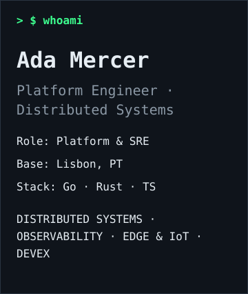 |
| Minimal — quiet project presentation | 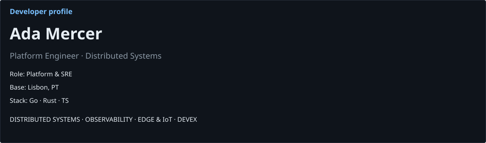 |
| Open source — repositories and contribution calendar | 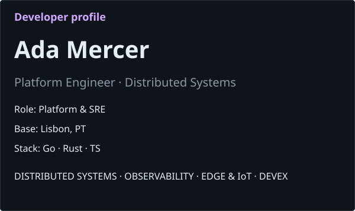 |
| Learning journey — skills and work in progress | 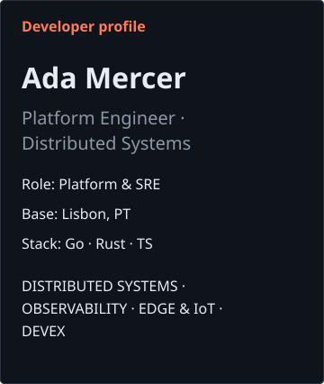 |
| Portfolio — projects and manually supplied milestones | 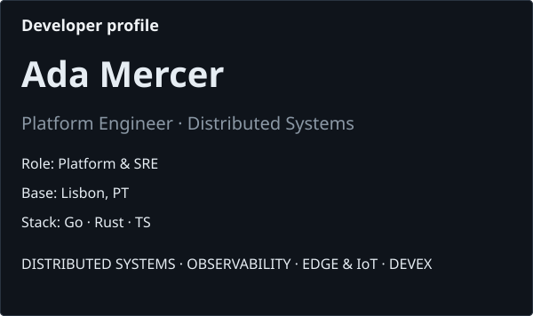 |
| Resume — skills and milestones before projects | 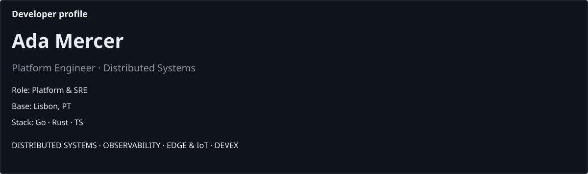 |
| Research notebook — ongoing work and a chronological record | 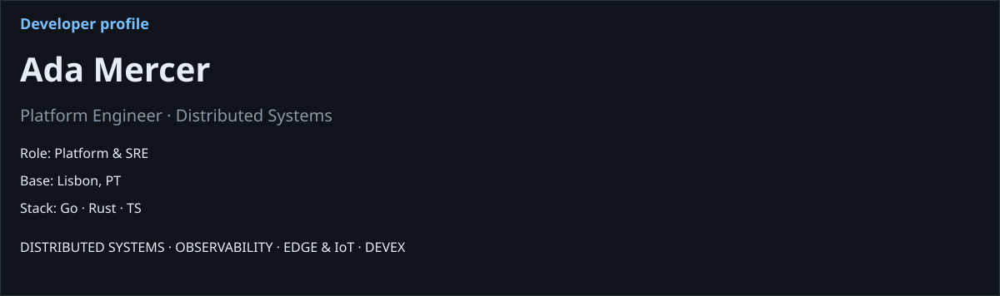 |
| Maker bench — narrow technical workbench | 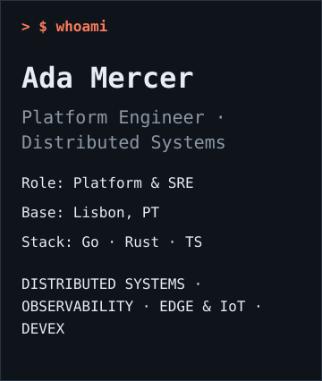 |
| Community — current work, projects and collaboration | 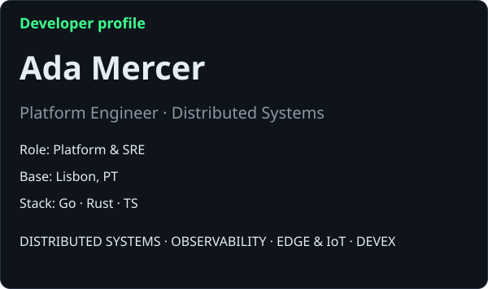 |

Example configuration:

    {
      "schemaVersion": 1,
      "login": "your-login",
      "preset": "terminal",
      "presetVersion": 1,
      "theme": "violet",
      "layout": { "projectColumns": 1 }
    }

The preset chooses defaults; violet overrides its normal phosphor palette. Use the Studio to preview all fields before exporting.

## Additional widgets

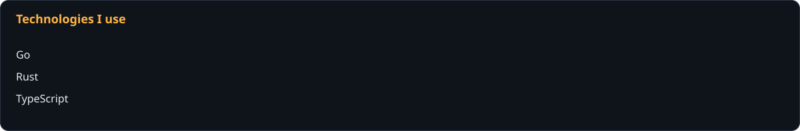

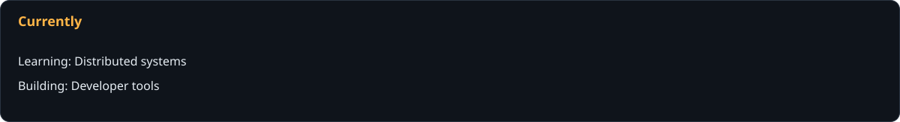

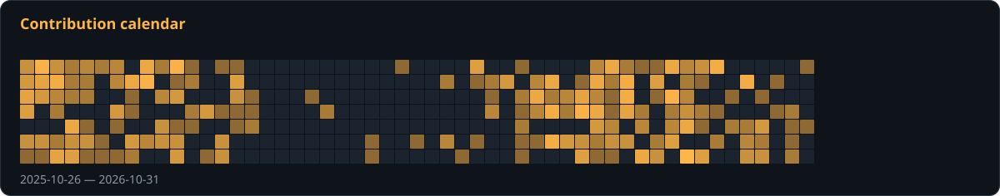

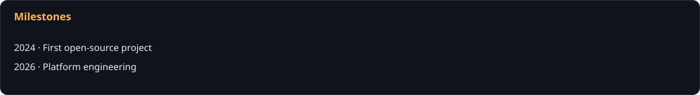

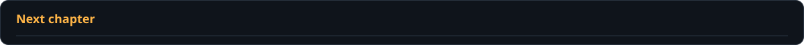

Run npm run preview to regenerate these examples from the committed fixture.
