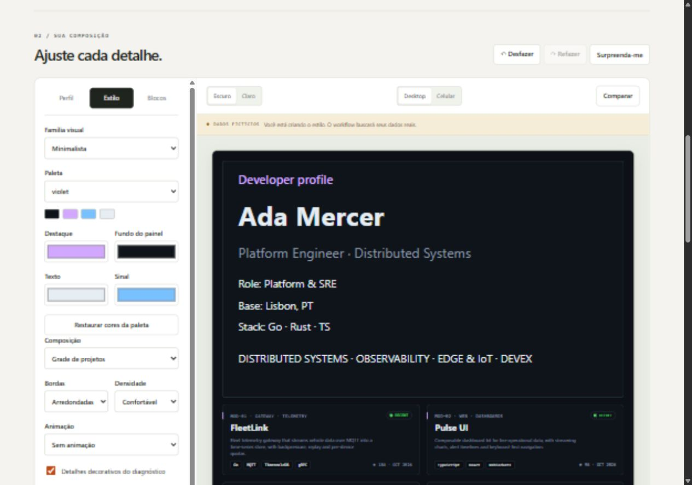

# Profile Studio

Studio edits the same configuration and SVG engine used by the CLI and Action. It runs locally with fictional data and does not request a GitHub token.

## Start

    npm ci
    npm run studio

Open the printed Local URL. npm run build:studio writes a static website to dist/site, including the shared renderer and fictional fixture. Relative URLs support repository subpaths.

## Create a profile

1. Choose Diagnostic console, Terminal, Minimal, Open source, Learning journey or Portfolio.
2. Edit login, name, bio, focus tags and readouts. Replace fictional sample names, projects, contacts and locations before installing.
3. Choose a palette independently of the visual family. Adjust per-mode colors, borders, motion and layout.
4. Add, hide or reorder blocks. Arrow buttons are available alongside drag-and-drop.
5. Compare with a reference, inspect mobile width and check both modes.
6. Export the configuration and installation kit.

Blocks: header, contacts, projects, telemetry, spectrum, footer, skills, currently learning/building, contribution calendar, milestones and divider. Skills and milestones are supplied manually, without inferred skill levels.

## Installation kit

The ZIP contains diagnostic-profile.json, .github/workflows/profile.yml, README.snippet.md and INSTALL.txt. The separate preview/ folder contains FICTIONAL SVGs rather than real GitHub statistics.

The generated workflow matches the selected asset repository/branch. main, master and develop cannot be asset branches; the workflow also checks the actual default branch. A different repository requires the PROFILE_PUBLISH_TOKEN secret with appropriate write access.

The Action currently uses the documented develop pre-release reference and must be accessible from the calling repository. Public source distribution, stable releases and Marketplace publication remain release tasks.

## Layout behavior

- Standard retains wide diagnostic panels.
- Compact uses 360-pixel main panels/project cards and incorporates projects in one column.
- Grid uses medium-width simple panels and explicit project columns.
- Two columns remain two columns on narrow READMEs. Choose Compact or one column for larger text.
- Automatic theme selection uses picture sources. Simple Markdown uses a fixed image; automatic mode falls back to dark.
- Group alignment applies to HTML project/contact groups, not plain Markdown.
- A plain-text metric summary is available alongside images.
- Reduced-motion CSS is included in the Studio and SVGs.

Studio controls use Brazilian Portuguese; generated system labels currently use English. Custom profile text is preserved as supplied. Additional locales remain planned.

## Save and share

Drafts and favorites stay in the browser when local storage is available. Download JSON for a portable copy. Imports and shared links are validated; unsupported fields, including credential fields, are discarded.

Shared links contain profile texts and contacts in the URL fragment. Localhost links only work where the same server is reachable; use the hosted Studio origin to share with other people. Oversized configurations should be shared as files.

## Contribute

Presets in src/presets.mjs declare versioned defaults; explicit settings override them. Widget types are listed in src/catalog.mjs, validated in src/design.mjs and composed in src/build.mjs. Each instance has a unique id, type, enabled flag and optional title. No two instances may produce the same filename.

Update the schema, warnings, tests and gallery for new fields. Run npm test, npm run preview and npm run build:studio. XML/schema checks complement manual inspection; screen-reader sessions and a rendered GitHub README check remain separate verification.

