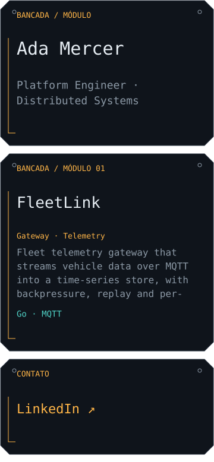
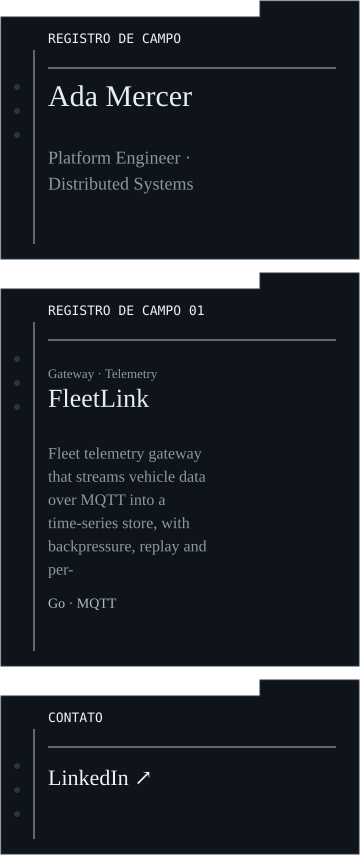
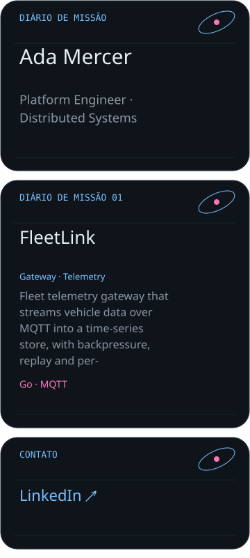
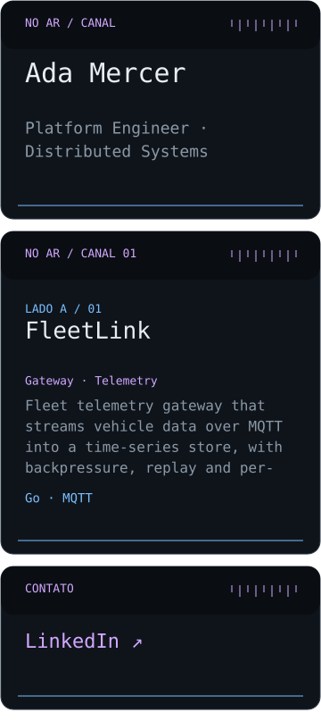
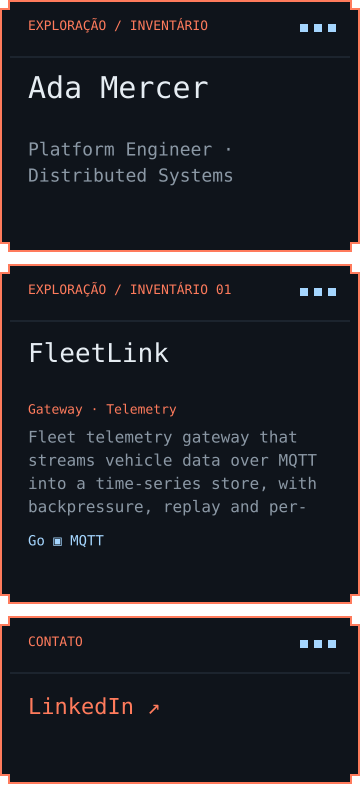
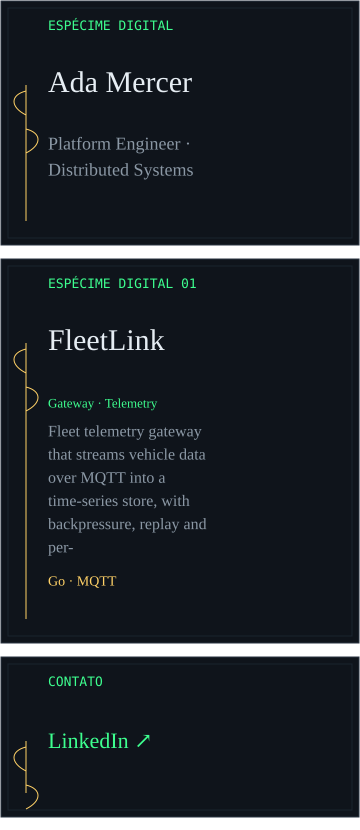

# Mundos e receitas

Por [Yago Borba](https://github.com/YagoBorba) · [Diagnostic Profile](https://github.com/YagoBorba/diagnostic-profile).

A versão 0.2.0 tem 16 modelos, seis paletas e nove famílias. Os modelos escolhem composição e defaults; a família define também formas, tipografia e tratamento dos blocos. As famílias anteriores continuam disponíveis.

| Mundo | Composição | Exemplo com dados fictícios |
| --- | --- | --- |
| Oficina Zero | Bancada técnica, trilhas, módulos e registros |  |
| Arquivo de Campo | Fichas, abas, margens e tipografia editorial |  |
| Cartografia Orbital | Diário de missão e geometria orbital |  |
| Estação de Rádio | Canais, faixas e marcas de sintonia |  |
| Inventário de Exploração | Molduras pixeladas e ferramentas declaradas |  |
| Herbário Digital | Pranchas, margens botânicas e catálogo de projetos |  |

Escolha Compacta para leitura em telas pequenas. A composição ampla não deve ser apenas encolhida em um README estreito. As cores personalizadas mostram avisos de contraste; confira claro e escuro antes de exportar.

## Três formas de publicar

| Formato | Preview e arquivos | Atualização |
| --- | --- | --- |
| Kit visual estático | SVGs do conteúdo preenchido, README com caminhos relativos e configuração | Manual: importe o JSON, edite e envie os novos arquivos |
| Markdown | Textos e links do mesmo modelo semântico usado na exportação | Manual: copie ou envie README.md |
| Action | Preview fictício, JSON, workflow e snippet; a execução consulta dados públicos reais | Pelo workflow do usuário |

O kit estático não inclui métricas, calendário ou consulta de projetos fixados. Adicione projetos manualmente. Ondas e figuras decorativas não medem desempenho. Não há XP, ranking ou nível de habilidade inventado. O README recebe imagens e links; as interações do playground ficam no Studio.

## Misture e guarde

Digite uma semente e use Surpreenda-me. As travas podem preservar mundo, cores, layout/blocos e movimento; o conteúdo pessoal é sempre mantido. A mesma semente e as mesmas opções reproduzem a escolha. Desfazer agrupa digitação no mesmo campo e mantém até 40 transações.

Receitas compartilham somente as opções visuais, com IDs de blocos normalizados e sem títulos personalizados, nomes ou contatos. Perfil completo é uma opção separada e inclui seus textos: revise antes de compartilhar. Favoritos são locais ao navegador, têm nome editável e miniatura; baixe JSON para um backup portátil.

Os pequenos desafios mudam a seleção de blocos, não apagam conteúdo e não bloqueiam a exportação. Os créditos para Yago Borba e o repositório permanecem nos formatos gerados.

## Contribuir com um mundo

Cada família declara autor, licença, versão, formatos e widgets suportados em src/families.mjs. A arte desta distribuição é vetorial original, MIT. Contribuições precisam identificar origem/licença e oferecer composição coerente, inclusive projetos, contatos e rodapé.

Execute npm test, npm run preview e npm run proof. A folha em dist/proof/index.html contém exemplos claros/escuros, estreitos/amplos e textos extremos; a CI anexa essa folha como artefato por três dias. Para servir localmente, use npm run proof -- --serve. A folha exige inspeção humana: XML e coordenadas não comprovam sozinhos legibilidade ou experiência com leitor de tela.
