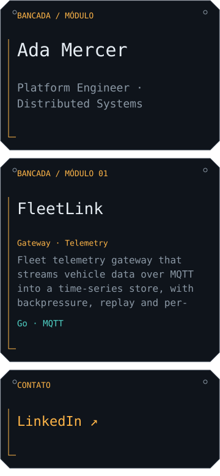
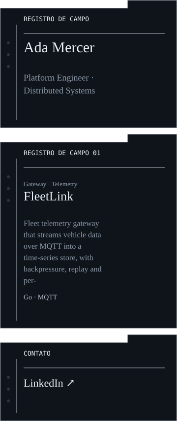
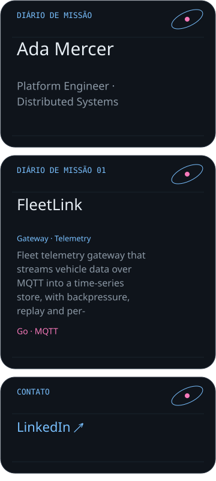
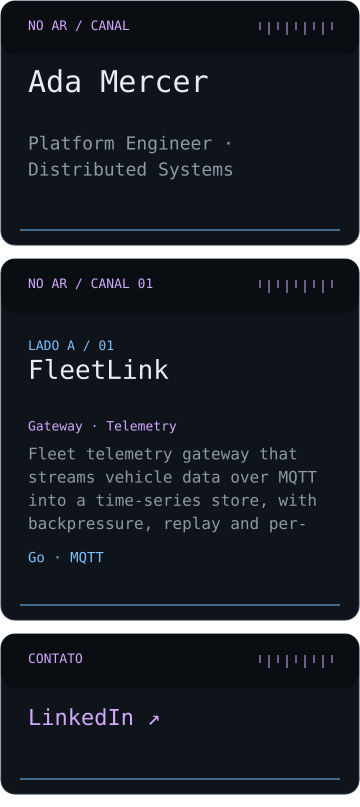
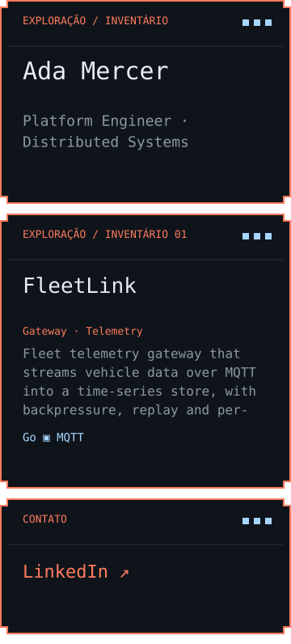
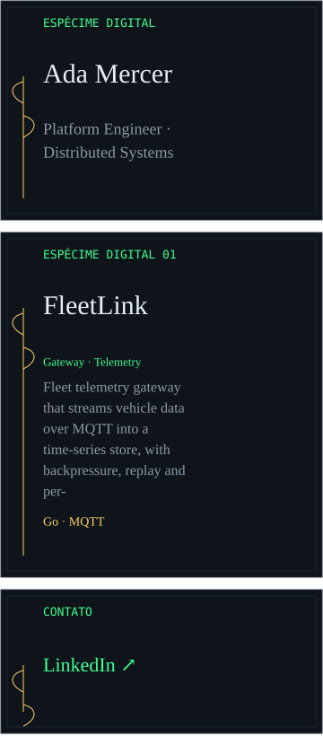

# Worlds and recipes

By [Yago Borba](https://github.com/YagoBorba) · [Diagnostic Profile](https://github.com/YagoBorba/diagnostic-profile).

Diagnostic Profile has 16 presets, six palettes and nine families. Presets choose the composition and defaults; the family also defines shapes, typography and how blocks are drawn. The original families remain available.

| World | Composition | Example with fictional data |
| --- | --- | --- |
| Oficina Zero | Technical workbench, tracks, modules and logs |  |
| Arquivo de Campo | Index cards, tabs, margins and editorial type |  |
| Cartografia Orbital | Mission log and orbital geometry |  |
| Estação de Rádio | Channels, bands and tuning marks |  |
| Inventário de Exploração | Pixel frames and declared tools |  |
| Herbário Digital | Plates, botanical margins and a project catalog |  |

Choose **Compacta** (compact) for reading on small screens; the wide composition should not simply be shrunk into a narrow README. Custom colors show contrast warnings; check light and dark mode before exporting.

## Three ways to publish

| Format | Preview and files | Updates |
| --- | --- | --- |
| Static visual kit | SVGs of the content you entered, a README with relative paths and the configuration | Manual: import the JSON, edit it and upload the new files |
| Markdown | Text and links from the same semantic model used by the export | Manual: copy or upload README.md |
| Action | Fictional preview, JSON, workflow and snippet; the run fetches real public data | Through your workflow |

The static kit does not include metrics, the calendar or pinned projects. Add projects by hand. Decorative waves and figures do not measure performance. There is no XP, ranking or invented skill level. The README gets images and links; the playground interactions stay in the Studio.

## Mix and keep

Type a seed and use **Surpreenda-me** (surprise me). Locks can keep the world, colors, layout and blocks, or motion; personal content is always kept. The same seed and options reproduce the same choice. Undo groups typing in the same field and keeps up to 40 steps.

Recipes share only the visual options, with normalized block IDs and without custom titles, names or contacts. A full profile is a separate option and includes your text: review it before sharing. Favorites stay in the browser, with an editable name and a thumbnail; download the JSON for a portable backup.

Small challenges change the block selection, never erase content and never block the export. Credits to Yago Borba and the repository stay in the generated formats.

## Contribute a world

Each family declares its author, license, version, formats and supported widgets in src/families.mjs. The artwork in this distribution is original vector art under MIT. Contributions must state their origin and license and offer a coherent composition, including projects, contacts and the footer.

Run npm test, npm run preview and npm run proof. The sheet at dist/proof/index.html has light and dark, narrow and wide examples and extreme text; CI attaches it as an artifact for three days. To serve it locally, use npm run proof -- --serve. The sheet is for human inspection: XML checks and coordinates alone do not prove readability.
